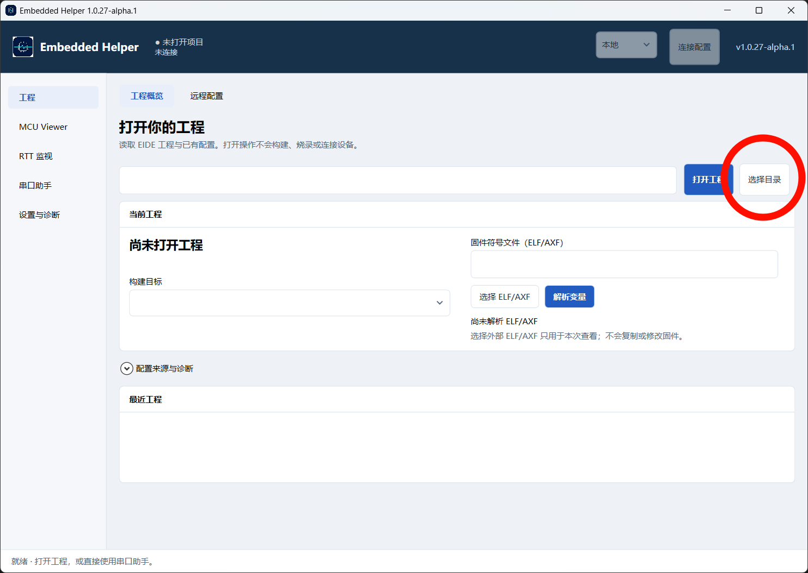
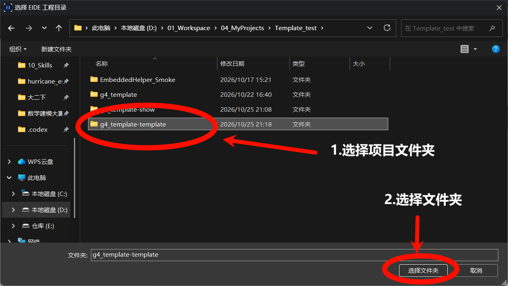
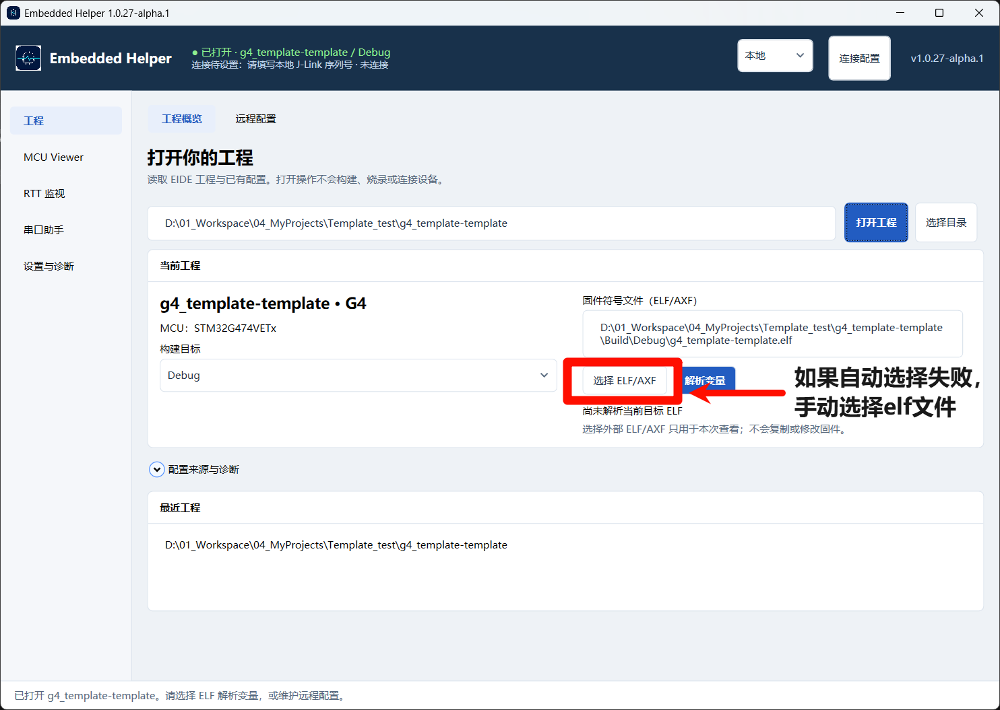
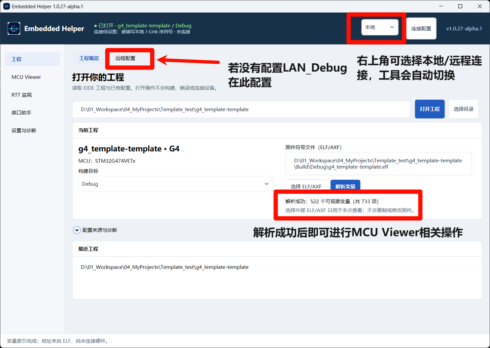
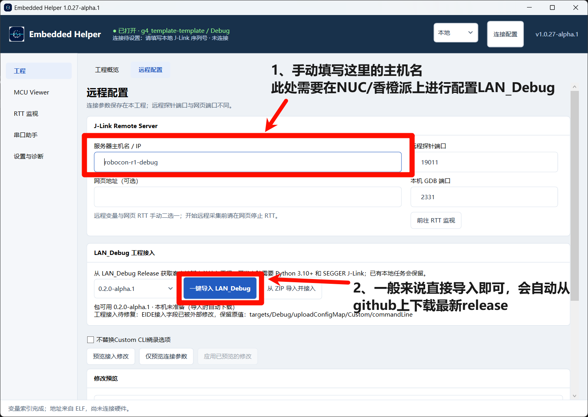
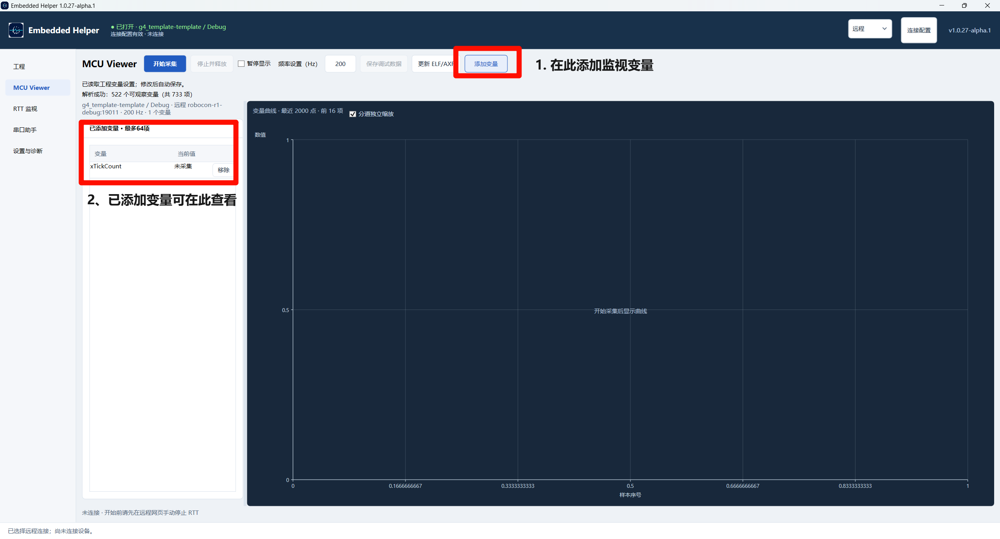

# Embedded Helper

**🛠️ 给战队模板配一个 N 合一调试小助手。**

看变量、画曲线、读 RTT、发串口，再给工程接上远程调试，尽量在一个窗口里完成。Embedded Helper 配合 **VS Code + EIDE** 使用，代码编辑、构建和源码调试仍在 IDE 中进行。

我想做的是 **N 合一**：把战队常用的调试工具和工程配置串起来。目前主要适配战队的 **G4、H7、F4、F1 FreeRTOS 模板**，其他工程的兼容性还需要逐步验证，F1 裸机暂不支持。

## 相比 MCUViewer，重点优化了什么？

[MCUViewer](https://mcuviewer.com/) 已经提供变量绘图、SWO 跟踪和高速记录。Embedded Helper 更关注战队日常使用的便利：

- **跟着工程走**：读取 EIDE 工程、目标和 ELF/AXF，变量列表、采样率和共享连接保存在工程中，方便接着调或交给队友。
- **常用工具放一起**：变量曲线、RTT 和独立串口助手集中在同一个客户端，减少来回切换。
- **接上战队远程环境**：导入 LAN_Debug 脚本并生成 VS Code 烧录、调试任务，省去手工配路径和命令。
- **调试完方便复盘**：曲线按需勾选显示，完整采集记录可导出 Excel。

优势主要在**模板适配和工具整合**。目前本地采集以 J-Link 为主，尚未与 MCUViewer 做采样性能对比，也未提供 SWO 或高速记录能力。界面中的“MCU Viewer”是本项目的变量观察页面。

## 下载与准备

从 [Releases](https://github.com/Jackrainman/embedded_helper/releases) 下载 `EmbeddedHelper.exe`，放到可写目录运行；使用 ZIP 时先完整解压。**客户端无需另装 .NET、Python 或开发 SDK。**

| 要做的事 | 需要准备 |
| --- | --- |
| 运行客户端 | Windows x64；首批验证环境为 Windows 11 x64 |
| 本地变量、RTT | SEGGER J-Link 软件及驱动、探针、目标板 |
| 解析 ELF | 通常使用内置解析；按提示补充 `arm-none-eabi-readelf.exe` |
| 远程烧录、调试 | 开发电脑安装 Python 3.10+ 和 SEGGER J-Link，远端 LAN_Debug 服务可用 |
| 串口收发 | 本地 COM 设备及驱动，无需打开工程 |

首次启动会在 EXE 旁创建 `data`，保存设置、工具缓存、内部组件和日志。**升级只替换 EXE，迁移时带上整个 `data`**；工程配置仍留在原工程里。

## 跟着截图上手

> 截图来自 `1.0.27-alpha.1`。当前版本已将“选择目录”和“打开工程”合并为“打开工程”，变量旁新增“显示”勾选框，分道独立缩放默认关闭；操作以本文说明为准。

### 1. 打开工程，解析变量

进入 **工程 → 工程概览**，点击 **打开工程**，选择工程根目录后直接加载。也可以输入目录或 `.code-workspace` 路径后按 Enter；取消选择会保留当前工程。

<details>
<summary>查看工程入口与目录选择示例</summary>





</details>

选择构建目标，确认自动识别的 ELF/AXF；没有找到时点击 **选择 ELF/AXF**，再点击 **解析变量**。固件请先在 EIDE 中构建，并确保 ELF 与目标板当前固件匹配。



打开工程只读取配置，不会自动构建、烧录、复位或连接设备。重新启动会尝试恢复上次工程，不会自动开始采集。

### 2. 配好本地或远程连接

**本地使用：** 在 **设置与诊断** 自动查找或手动指定 `JLink_x64.dll`，按需配置 ELF 解析工具。再点击右上角 **连接配置 → 刷新探针**，选择目标 J-Link 并 **保存共享连接**。

**远程使用：** 先在 NUC、香橙派等远端主机部署 LAN_Debug 服务，再到 **工程 → 远程配置** 填写服务器主机名/IP、远程探针端口和所需网页地址。顶部的 **本地/远程** 切换可视化连接方式，不会自动连接或改变 EIDE 烧录方式。



选择客户端版本，点击 **一键导入 LAN_Debug**，检查应用结果后，在 VS Code 中使用生成的远程烧录或调试任务。下载的是界面所选版本；也可通过 **从 ZIP 导入并接入** 使用官方客户端 ZIP。



导入默认写入 EIDE Custom CLI 烧录配置；要保留原配置，先勾选 **不替换 Custom CLI 烧录选项**。导入本身不执行烧录或调试；出现配置冲突时会停止并提示。顶部配置有效，也不代表设备已经连接。

### 3. 添加变量，开始采集

进入 **MCU Viewer → 添加变量**，按名称、完整成员路径或类型搜索并添加，最多 64 项。设置请求频率后按 Enter 或移开焦点保存，再点击 **开始采集**。



- 变量旁的 **显示** 默认勾选；取消后只隐藏曲线，数值、采集和记录继续。勾选状态仅用于当前工程会话。
- 曲线显示已勾选且有数据的前 16 项，每项保留最近 2000 点。**分道独立缩放默认关闭**，勾选显示的变量不超过两个时可手动开启。
- **暂停显示** 冻结数值和曲线，后台继续记录；暂停时切换曲线显示仍使用原快照。添加、移除变量或改频率前，先停止采集。
- 结束后点击 **停止并释放**，再用 **保存调试数据** 导出 `.xlsx`。导出包含全部已接收批次、时间和完整变量名，不受 2000 点显示上限影响。

请求频率不等于实际采样率。ELF 更新后要重新解析，并确认与已烧录固件一致。

## RTT 与串口

**RTT：** 本地打开工程、保存共享连接后，进入 **RTT 监视 → 开始本地 RTT**，读取 Up 通道 0，无需解析 ELF。远程使用 **打开远程 RTT 网页**，在网页中查看和停止。

**变量与 RTT 共用连接，切换前先停止并释放。** 远程变量与网页 RTT 也需手动二选一；使用其他烧录或调试工具前，同样先释放 J-Link。

**串口：** 无需工程即可使用。选择 COM 口和参数后打开，支持文本/HEX 收发、换行设置、周期发送和双向原始记录。**冻结当前并分栏** 可保留右侧快照，左侧继续接收；清屏只清实时侧。记录保存在 `data/serial/records/`，停止变量或 RTT 不会关闭串口。

串口常规支持到 1 Mbps，5 Mbps 为实验档；RS485 依赖转接器自动换向，暂不支持 TCP 远程串口。发送成功计数表示驱动接受数据，不代表对端已处理。

## 遇到问题先看这里

| 问题 | 先检查 |
| --- | --- |
| 找不到 J-Link、无法采集 | DLL 路径、驱动、目标供电、所选探针及是否被其他程序占用 |
| ELF 解析失败、变量找不到 | 构建目标、文件是否匹配、是否需要外部 `arm-none-eabi-readelf.exe` |
| 远程配置有效但连不上 | 服务器地址、探针端口、服务状态；网页端口与探针端口不同 |
| 串口打不开或发不出去 | COM 占用、通信参数和串口详细诊断 |
| 需要排查日志 | **设置与诊断 → 打开日志目录**，对应 `data/logs/` |

当前变量采集支持固定地址的全局/静态标量及结构体、定长数组中的基础数值成员，类型为 8/16/32 位整数和 `float32`；不支持位域、匿名成员、联合体、指针跟随、64 位数值、局部变量或任意表达式，也不提供完整源码调试器。

> 当前为开发内测版本。模板适配、硬件链路及纯净 Windows 的实际验证范围以 Release 说明为准，软件检查通过不代表全部实机验收完成。

## 开发与文档

源码开发使用 C# / WPF、Git、Python 3.12+（标准库 Harness）和 [global.json](global.json) 锁定的 **.NET SDK 10.0.403**；产品版本见 [VERSION](VERSION)。

```bash
# 首次克隆后安装提交钩子
python scripts/verify.py --install-hooks

# 仓库文档、边界和 Harness 检查；不构建客户端
python scripts/verify.py

# 只检查客户端工程和精确 SDK 是否就绪
python scripts/verify.py --client-preflight

# 锁定恢复、格式检查、Release 构建和 C# 测试
python scripts/verify.py --client

# 从干净已提交基线打包并运行同包 GUI/CLI 自检
python scripts/package_client.py
```

打包产物默认在 `dist/candidate/`。详细配置、数据位置和维护规则见：

- [需求规格说明书](.docs/01_需求规格说明书.md)
- [概要设计说明书](.docs/02_概要设计说明书.md)
- [详细设计说明书](.docs/03_详细设计说明书.md)
- [开发工作约定](AGENTS.md)
- [手动验收与环境状态](.harness/test.json)
